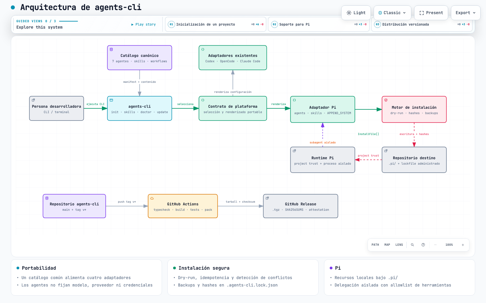

[](https://github.com/matiasnjacob/agents-cli/releases/latest)
[](https://www.npmjs.com/package/@matiasnjacob/agents-cli)
[](https://github.com/matiasnjacob/agents-cli/actions/workflows/ci.yml)

# agents-cli

`agents-cli` initializes a new repository with a portable, auditable catalog
of agent definitions, platform-specific configuration, selected skills, and
project workflow guidance.

It is designed for people who want the same development roles and conventions
in every project without copying private home-directory configuration. The
catalog preserves seven portable roles and renders them for
Codex, OpenCode, Claude Code, or Pi.

Install the published CLI from npm as `@matiasnjacob/agents-cli`. Check the
installed version with `agents-cli --version`, then run `agents-cli setup` to
configure a project.

## Architecture

[](docs/architecture/agents-cli.html)

The [interactive architecture diagram](docs/architecture/agents-cli.html) shows
the canonical catalog, platform adapters, safe installation engine, Pi runtime
integration, and versioned release pipeline. Its validated Archify source is
available at [`docs/architecture/agents-cli.architecture.json`](docs/architecture/agents-cli.architecture.json).

## What it installs

An initialization writes only into the target repository and records managed
file hashes in `.agents-cli.lock.json`. Existing unrelated files are preserved;
edited managed files become explicit conflicts instead of being silently
overwritten.

Depending on the selected platform, generated files are placed under:

| Platform | Agent files | Project instructions |
| --- | --- | --- |
| Codex | `.codex/agents/*.toml` | `.codex/AGENTS.md` |
| OpenCode | `.opencode/agents/*.md` | agent front matter and project files |
| Claude Code | `.claude/agents/*.md` | `CLAUDE.md` |
| Pi | `.pi/agents/*.md` + `.pi/extensions/agents-cli-subagent.ts` | `.pi/APPEND_SYSTEM.md` |

The generated files are derived artifacts. Change the catalog or selected
skills rather than adding credentials or machine-specific absolute paths to
them.

## The canonical agents

The catalog contains these seven roles:

| Agent | Responsibility |
| --- | --- |
| `orchestrator` | Plans delivery, refines scope, coordinates specialists and independent review. |
| `backend-developer` | Implements backend APIs, business logic, persistence and backend tests. |
| `frontend-developer` | Implements accessible frontend behavior, client integration and UI tests. |
| `aws-specialist` | Designs AWS integrations, infrastructure and operational workflows with explicit authorization for cloud mutations. |
| `code-reviewer` | Independently reviews correctness, security, architecture, regressions and test coverage. |
| `qa-automator` | Finds coverage gaps and authors deterministic automated tests against acceptance criteria. |
| `qa-manual` | Performs exploratory and functional acceptance testing and records reproducible evidence. |

Roles are intentionally separate from model selection. `agents-cli` does not
pin a model, provider or account for the generated agents.

## Supported platforms

### Codex

Renders named TOML agents in `.codex/agents/` and project instructions in
`.codex/AGENTS.md`. Codex sandbox, approval and runtime settings remain
authoritative over textual instructions.

### OpenCode

Renders Markdown agents in `.opencode/agents/`. The installer does not create
or replace `opencode.json`, so existing models, providers, MCP servers and
plugins are preserved.

### Claude Code

Renders Markdown agents in `.claude/agents/` and project instructions in
`CLAUDE.md`. Textual instructions cannot enforce permissions that the Claude
Code runtime does not support; those differences are documented rather than
promised as hard restrictions.

### Pi

Renders project roles in `.pi/agents/`, native Agent Skills in `.pi/skills/`, and a project extension exposing a `subagent` tool. Each delegation runs in an isolated Pi subprocess that inherits the active model and thinking level. Pi project trust and generated tool allowlists remain authoritative; source `ask` and path-specific policies are documented intent rather than runtime enforcement. See [the Pi adapter guide](docs/pi.md).

## Skills

Skills are selected after the platform is resolved. The eight portable skills in
the current catalog are:

- `code-review-pr`
- `developer-task-execution`
- `engram-session` — every agent syncs its Engram memory session before work and saves it before reporting
- `functional-review`
- `git-feature-workflow`
- `orchestrator-governance`
- `qa-test-evidence` — QA agents generate test cases with JEV and record Playwright evidence
- `worktree-task-isolation`

`brainstorming` (from [skills.sh](https://skills.sh), `obra/superpowers`, pinned to a commit) is always installed for every agent and platform; `agents-cli skills update` moves its pin.

The catalog also exposes `skills.sh` as an external source. External skills are downloaded only when selected in setup with an explicit GitHub repository, full commit SHA and skill path. The installer preserves text resources, records a license file and provenance, and never executes skill scripts. Project-scoped or
private variants from the source machine are not copied into the portable
catalog by default.

## Installation

### From npm

Install the CLI globally and verify that your shell resolves the expected
version before starting the interactive setup:

```sh
npm install --global @matiasnjacob/agents-cli
agents-cli --version
agents-cli setup
```

Node.js 20 or newer is required. The setup command uses arrow keys and Enter
for single choices, and arrow keys, Space and Enter for multi-selects. Choose
a suite, platform, MCPs, skills, optional JEV decision support, and an optional
lowercase kebab-case project prefix such as `acme` for generated agent names.

If `--version` or `setup` is reported as unknown, check `command -v agents-cli`
and `npm list --global @matiasnjacob/agents-cli`. Your shell may be resolving a
different or older `agents-cli` executable than the scoped npm package.

### From a GitHub Release

Download the `.tgz` asset from the [Releases](https://github.com/matiasnjacob/agents-cli/releases)
page, verify its checksum, and install it locally:

```sh
curl -LO https://github.com/matiasnjacob/agents-cli/releases/download/v0.3.0/agents-cli-0.3.0.tgz
curl -LO https://github.com/matiasnjacob/agents-cli/releases/download/v0.3.0/SHA256SUMS
grep agents-cli-0.3.0.tgz SHA256SUMS | sha256sum --check
npm install --global ./agents-cli-0.3.0.tgz
```

For a one-command installation of the latest stable release on macOS or
Linux, download and run the installer after reviewing it:

```sh
curl -fsSL https://raw.githubusercontent.com/matiasnjacob/agents-cli/main/install.sh -o install.sh
less install.sh
bash install.sh
```

Set `AGENTS_CLI_VERSION=0.3.0` to install a specific release, or
`AGENTS_CLI_REPOSITORY=owner/repository` when using a compatible fork. The
installer resolves stable releases through the GitHub API, downloads the
tarball and `SHA256SUMS`, verifies the checksum, then runs `npm install --global`.
It never parses the Releases HTML page. Windows PowerShell is not supported by
this script yet.

The release asset is a Node.js package, so Node.js 20 or newer and npm are
required. The release workflow produces the tarball and checksum only after
typecheck, build and tests pass.

### From a checkout

For development or contribution:

```sh
git clone https://github.com/matiasnjacob/agents-cli.git
cd agents-cli
npm ci
npm run build
```

## Quick start

Run `agents-cli setup` for interactive selection of one or more platforms (for example Codex + Claude Code), suite, MCP integrations, skills and optional JEV. It shows progress, a short plan summary and a confirmation, then ends with `Setup complete.` and a checklist of what is left to do. It writes a reproducible `agents-cli.config.json`; when MCPs need credentials it also creates a `.env` with empty placeholders, a `.envrc` for direnv and a `.gitignore` entry (never overwriting existing values). For automation, use `agents-cli setup --config <file> --yes`, or preview with `--dry-run`. See [interactive setup](docs/setup.md) and [JEV decision support](docs/jev.md).


Select the platform and tracker explicitly. `none` means no tracker is
created or required.

```sh
agents-cli init --platform codex --tracker linear
agents-cli init --platform opencode --tracker trello
agents-cli init --platform claude --tracker none
agents-cli init --platform pi --tracker none
```

For non-interactive automation, add `--yes`. Preview changes first with
`--dry-run`:

```sh
agents-cli init --platform codex --tracker none --skills git-feature-workflow --yes --dry-run
agents-cli init --platform codex --tracker none --skills git-feature-workflow --yes
```

`init` runs the same engine non-interactively. The command is idempotent. Run it again to see unchanged files; local edits
are reported as conflicts and are never silently discarded.

## Commands

```text
agents-cli --help
agents-cli --version
agents-cli setup [--config <file>] [--yes] [--dry-run]
agents-cli init --platform <codex|opencode|claude|pi> --tracker <linear|trello|none> [--skills <id,id>] [--yes] [--dry-run]
agents-cli check [--json]
agents-cli update [--dry-run] [--yes]
agents-cli uninstall [--dry-run] [--yes] [--json]
agents-cli revert [timestamp] [--list] [--dry-run] [--yes] [--json]
agents-cli import [--dry-run] [--json]
agents-cli doctor [--json]
agents-cli lint [--json]
agents-cli skills list --platform <codex|opencode|claude|pi>
agents-cli skills add <id> --platform <codex|opencode|claude|pi> [--dry-run]
agents-cli skills add <owner/repo> --path <dir> [--ref <sha|branch|tag>] [--id <id>] [--dry-run] [--yes]
agents-cli skills update [id] [--dry-run] [--yes]
agents-cli suites list
agents-cli mcp list --platform <codex|opencode|claude|pi>
agents-cli decision <tool> --input <file|-> [--config <file>]
agents-cli decision mcp [--config <file>]
agents-cli decision evaluate --dataset <file> --output <file> [--config <file>]
```

`doctor` prints a readable report in a terminal (JSON with `--json` or when piped). It checks runtime, catalog, lockfile, platform, MCP configuration, the environment variables your MCPs need (set in the environment or filled in `.env`, never printed), direnv, the Engram hooks and external actor diagnostics. A reachable Docker daemon does not by itself prove that a Linear or GitHub MCP tool call is authorized.

**Lifecycle.** `check` is read-only and exits 1 when installed files drift from the catalog or have conflicts; it also reports pinned external skills that are behind upstream. `update` applies the configured setup again with the same plan and confirmation as `setup`. Locally edited files are never overwritten: they stay conflicts. `uninstall` removes only files whose hash still matches the lockfile and the MCP entries agents-cli owns (your own entries, `.env`, `.envrc` and `.gitignore` are untouched), after saving backups; `revert` restores a backup and itself backs up first.

**Skills and existing projects.** `skills add owner/repo --path <dir>` pins any GitHub skill to a commit after the license, symlink and resource checks, and works with private repositories through your git credentials. `import` indexes an existing `AGENTS.md`, `CLAUDE.md`, Cursor rules or MCP server names into `.agents/imported.md` for the agents to read, without copying content or secrets.

**Enforcement and control.** With the `engram` MCP on Claude Code, setup installs managed hooks: `Stop` blocks once when a session used tools but never saved its Engram summary, and `SessionStart` loads recent memory (skipped when the Engram plugin is enabled). Per-project `permissions` in `agents-cli.config.json` narrow (or, with `allowPermissionWidening`, widen) each agent's catalog permissions and are applied by every adapter. `lint` validates the catalog itself (manifest sync, front matter, hashes, permissions, skill references) and also runs in the test suite. Details: [setup](docs/setup.md), [update and lifecycle](docs/doctor-update.md).

## Worktrees and project workflows

Use one worktree per task under the primary checkout:

```sh
git worktree add ".worktrees/<task>" -b "feature/<task>" origin/main
git worktree list
```

`.worktrees/` is ignored by Git. The reusable workflow catalog includes
templates for [Linear stories](catalog/workflows/linear-story.md), [Trello
cards](catalog/workflows/trello-story.md), and [worktree execution](catalog/workflows/worktree.md).
Tracker selection remains explicit; `init --tracker none` does not impose a
tracker or create stories automatically.

## Graphify

Graphify is an optional local tool and is documented separately in
[catalog/workflows/graphify.md](catalog/workflows/graphify.md). The current
workflow verifies Graphify `0.9.48` commands for platform installation,
index/update and pending-update checks. Generated `graphify-out/` data is
excluded from Git.

`agents-cli` does not yet wrap Graphify. The supported repository,
configuration ownership and future CLI integration boundary remain an open
decision.

## External integrations and identity

GitHub and Linear workflows are administered through Docker MCP Toolkit in the
development environment. Automated repository operations use a GitHub App
identity; Linear operations use a distinguishable bot alias. Credentials,
tokens, private keys, histories and caches are never part of the catalog or
release assets.

## Releases

Releases are created from version tags:

```sh
git tag v0.3.0
git push origin v0.3.0
```

The tag workflow runs `npm ci`, typecheck, build and the complete test suite.
It then uploads `agents-cli-<version>.tgz` and `SHA256SUMS` to a GitHub
Release and publishes a GitHub build-provenance attestation for the tarball.
Review the generated assets and attestation before sharing a release. The
attestation can be verified with GitHub's attestation tooling, for example:

```sh
gh attestation verify agents-cli-0.3.0.tgz --repo matiasnjacob/agents-cli
```

The scoped npm package is published through GitHub Actions OIDC. See
[npm publishing](docs/npm-publishing.md) for the registry setup and recovery steps.

## Development and validation

```sh
npm ci
npm run typecheck
npm run build
npm test
npm pack --dry-run
```

The integration suite uses temporary repositories and verifies all four
platforms, dry-run behavior, idempotency, preservation of unrelated files and
installation from a release tarball outside the source checkout.

See [PLAN.md](PLAN.md), [docs/integration-validation.md](docs/integration-validation.md)
and [docs/execution-status.md](docs/execution-status.md) for the roadmap,
evidence and known limitations.

Release history is maintained in [CHANGELOG.md](CHANGELOG.md).

## Contributing

Create a task worktree, keep changes scoped, add deterministic tests for
behavior changes, and open a pull request. Do not commit credentials,
generated `.worktrees/` content, local Graphify data or machine-specific
configuration.
